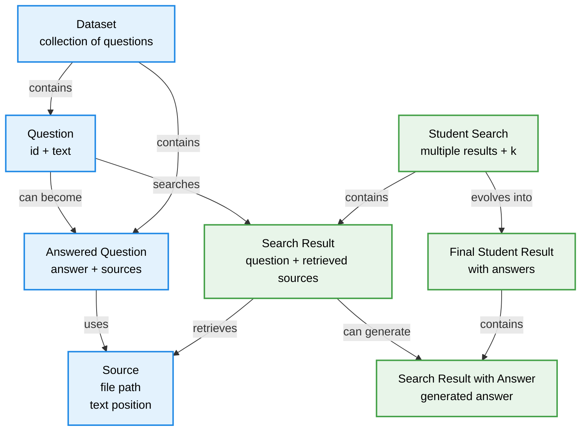

*This project has been created as part of the 42 curriculum by your_login, collaborator_login.*

# RAG Against the Machine

> A Python RAG (Retrieval-Augmented Generation) system that indexes the vLLM codebase and answers questions about it using BM25 retrieval + Qwen/Qwen3-0.6B generation.

---

## Table of Contents

1. [Description](#description)
2. [System Architecture](#system-architecture)
3. [Project Structure](#project-structure)
4. [Chunking Strategy](#chunking-strategy)
5. [Retrieval Method](#retrieval-method)
6. [Data Models](#data-models)
7. [Instructions](#instructions)
8. [Pipeline Usage (CLI)](#pipeline-usage-cli)
9. [Performance Analysis](#performance-analysis)
10. [Design Decisions](#design-decisions)
11. [Challenges Faced](#challenges-faced)
12. [Resources](#resources)

---

## Description

RAG Against the Machine is a Retrieval-Augmented Generation system built to answer questions about the vLLM codebase. It ingests a large Python/Markdown repository, splits it into semantically meaningful chunks, indexes them with BM25, and uses Qwen/Qwen3-0.6B to generate grounded answers from the retrieved context.

The project has four goals:

- **Ingestion goal**: parse, chunk, and index all relevant files from the vLLM repository into a searchable knowledge base.
- **Retrieval goal**: given a natural language question, find the top-k most relevant code or documentation chunks via BM25 scoring.
- **Generation goal**: pass retrieved context to a local LLM and produce a concise, evidence-based answer.
- **Evaluation goal**: measure retrieval quality using recall@k metrics and track system performance against required thresholds.

At runtime, the system:

1. Parses and validates the repository structure.
2. Chunks files according to their type (Python AST / text sliding window).
3. Builds and persists a BM25 index per file type.
4. Retrieves the top-k most relevant chunks for any query.
5. Assembles a context window and generates an answer with Qwen.
6. Exports structured JSON following the provided Pydantic models.

---

## System Architecture

### Global pipeline

```
┌──────────────────────────────────────────────────────────────┐
│                      CLI  (python-fire)                       │
│                                                              │
│   index · search · answer · search_dataset                   │
│   answer_dataset · evaluate                                  │
└───────────────────────────┬──────────────────────────────────┘
                            │
          ┌─────────────────▼──────────────────┐
          │           Ingestion Layer           │
          │                                    │
          │  Walk repo ──► Filter ──► Chunk    │
          │                                    │
          │   .py              .md/.rst/.txt   │
          │    │                    │          │
          │  AST chunker    Sliding-window     │
          │    │                    │          │
          │    └────────┬───────────┘          │
          │             │                      │
          │      Save chunks to disk           │
          │    data/processed/chunks/          │
          └─────────────┬──────────────────────┘
                        │
          ┌─────────────▼──────────────────────┐
          │             Index Layer             │
          │                                    │
          │  BM25 index (code)                 │
          │  data/processed/bm25_index/code/   │
          │                                    │
          │  BM25 index (docs)                 │
          │  data/processed/bm25_index/docs/   │
          └─────────────┬──────────────────────┘
                        │
          ┌─────────────▼──────────────────────┐
          │          Retrieval Layer            │
          │                                    │
          │  Query ──► Tokenize                │
          │    ├──► BM25 score (code)          │
          │    └──► BM25 score (docs)          │
          │              │                     │
          │         Merge & rank               │
          │              │                     │
          │      Top-k MinimalSource           │
          └─────────────┬──────────────────────┘
                        │
          ┌─────────────▼──────────────────────┐
          │          Generation Layer           │
          │                                    │
          │  Chunks ──► Context window         │
          │  (truncate to token budget)        │
          │              │                     │
          │       Qwen/Qwen3-0.6B              │
          │              │                     │
          │         answer: str                │
          └─────────────┬──────────────────────┘
                        │
          ┌─────────────▼──────────────────────┐
          │          Evaluation Layer           │
          │                                    │
          │  retrieved  vs  ground_truth        │
          │  overlap >= 5%  =>  found          │
          │                                    │
          │  Recall@1  @3  @5  @10             │
          └────────────────────────────────────┘
```

### Data flow for a single query

```
  User: "How does vLLM handle KV cache?"
         │
         ▼
  ┌─────────────────┐
  │    Retriever    │──── tokenize ────► BM25 code index ──► scores_code[]
  │                 │──── tokenize ────► BM25 docs index ──► scores_docs[]
  └────────┬────────┘
           │  merge + sort by score
           ▼
  [ MinimalSource, MinimalSource, ... ]  (top-k)
           │
           ▼
  ┌─────────────────┐   read file slices
  │    Generator    │──────────────────► context window (token budget)
  │                 │──► prompt + ctx ──► Qwen3-0.6B ──► tokens
  └────────┬────────┘
           │
           ▼
  MinimalAnswer {
    question_id, question,
    retrieved_sources, answer
  }
```

---

## Project Structure

```
rag-against-the-machine/
│
├── src/
│   ├── __main__.py               ← CLI entry point (Python Fire)
│   ├── models.py                 ← All Pydantic data models
│   │
│   ├── ingestion/
│   │   ├── __init__.py
│   │   ├── walker.py             ← Walk repo, filter by extension
│   │   ├── chunker_python.py     ← AST-based Python chunker
│   │   ├── chunker_text.py       ← Sliding-window text/Markdown chunker
│   │   └── chunk_store.py        ← Save / load chunks JSON to disk
│   │
│   ├── index/
│   │   ├── __init__.py
│   │   └── bm25_index.py         ← Build, save, load BM25 indexes
│   │
│   ├── retrieval/
│   │   ├── __init__.py
│   │   └── retriever.py          ← Query → top-k MinimalSource
│   │
│   ├── generation/
│   │   ├── __init__.py
│   │   └── generator.py          ← Context assembly + Qwen inference
│   │
│   └── evaluation/
│       ├── __init__.py
│       └── evaluator.py          ← recall@k metric
│
├── data/                         ← NOT committed (.gitignore)
│   ├── raw/
│   │   └── vllm-0.10.1/          ← vLLM source repository
│   ├── processed/
│   │   ├── chunks/
│   │   │   ├── code_chunks.json
│   │   │   └── docs_chunks.json
│   │   └── bm25_index/
│   │       ├── code/
│   │       └── docs/
│   ├── datasets/
│   │   ├── AnsweredQuestions/
│   │   │   ├── dataset_code_public.json
│   │   │   └── dataset_docs_public.json
│   │   └── UnansweredQuestions/
│   │       ├── dataset_code_public.json
│   │       └── dataset_docs_public.json
│   └── output/
│       ├── search_results/
│       └── search_results_and_answer/
│
├── tests/
│   ├── test_chunker_python.py
│   ├── test_chunker_text.py
│   ├── test_retriever.py
│   └── test_evaluator.py
│
├── pyproject.toml                ← uv project config + dependencies
├── uv.lock                       ← Locked dependency tree
├── Makefile
├── .gitignore
└── README.md
```

---

## Chunking Strategy

Different file types require different chunking strategies because their structure varies significantly.

### Python code chunking (AST-based)

```
  source.py  (raw text)
  ──────────────────────────────────────────────
  import os                          ← skipped

  class KVCache:                     ┐
      """Cache for KV pairs."""      │  chunk 1
      def __init__(self, size):      │  first_char_index =  12
          self.size = size           │  last_char_index  = 198
      def allocate(self, n):         │
          ...                        ┘

      def free(self, block):         ┐
          ...                        │  chunk 2
                                     ┘  first_char_index = 199
                                        last_char_index  = 312

  def build_cache(cfg):              ┐
      ...                            │  chunk 3
                                     ┘
  ──────────────────────────────────────────────
  If chunk > max_chunk_size → split at line boundaries
```

Each chunk is extracted via Python's `ast` module (`ast.FunctionDef`, `ast.ClassDef`). Character offsets are computed from the original source string and map exactly to `MinimalSource`.

### Text / Markdown chunking (sliding window)

```
  document.md
  ──────────────────────────────────────────────
  # Section A                        ┐
                                     │  chunk 1  (paragraph block)
  Lorem ipsum dolor sit amet...      ┘

  ## Subsection B                    ┐
                                     │  chunk 2
  Consectetur adipiscing...          ┘

  [very long paragraph > max_size]
  ┌─────────────────────────┐
  │  window 1  (0 → max)    │           chunk 3a
  └─────────────────────────┘
        ┌─────────────────────────┐
        │  window 2  (10% overlap)│      chunk 3b
        └─────────────────────────┘
  ──────────────────────────────────────────────
  Section header prepended to every chunk
```

### Configuring chunk size

```bash
uv run python -m student index --max_chunk_size 2000   # default
uv run python -m student index --max_chunk_size 800    # better recall on code
```

---

## Retrieval Method

### BM25 scoring formula

```
                     IDF(qi) * f(qi,D) * (k1 + 1)
  score(D,Q) =  SUM  ─────────────────────────────────────────
                 i    f(qi,D) + k1 * (1 - b + b * |D|/avgdl)

  qi     = query term i
  f(q,D) = term frequency in document D
  |D|    = document length (tokens)
  avgdl  = average document length across corpus
  k1     = 1.5   (term frequency saturation)
  b      = 0.75  (length normalisation strength)

  vs TF-IDF:
  · Saturates on high-freq terms  →  no spam bias
  · Normalises for length         →  short chunks not penalised
```

### Dual-index merge

```
  Query
    │
    ├──► BM25 code index ──► [(id, score), (id, score), ...]
    │     (.py files)
    │
    └──► BM25 docs index ──► [(id, score), (id, score), ...]
          (.md / .rst files)
                 │
                 ▼
         Merge by score
         Deduplicate by file_path
                 │
                 ▼
          Top-k MinimalSource
```

Keeping separate indexes avoids vocabulary pollution between code tokens (`def`, `self`, `return`) and natural-language tokens.

---

## Data Models



## Instructions

### Prerequisites

- Python `>= 3.10`
- `uv` — `curl -LsSf https://astral.sh/uv/install.sh | sh`

### Installation

```bash
make install
```

### Index the repository

```bash
uv run python -m student index --max_chunk_size 2000
```

### Quality checks

```bash
make lint          # flake8 + mypy standard flags
make lint-strict   # mypy --strict (optional)
```

### Run tests

```bash
uv run pytest tests/
```

### Cleanup

```bash
make clean
```

---

## Pipeline Usage (CLI)

### Step 1 — Index

```bash
uv run python -m student index --max_chunk_size 2000
# Ingestion complete! Indices saved under data/processed/
```

### Step 2 — Search a single query

```bash
uv run python -m student search "How does vLLM handle KV cache?" --k 5
```

### Step 3 — Answer a single question

```bash
uv run python -m student answer "How to configure the OpenAI compatible server?" --k 10
```

### Step 4 — Search a full dataset

```bash
uv run python -m student search_dataset \
  --dataset_path data/datasets/UnansweredQuestions/dataset_docs_public.json \
  --k 10 \
  --save_directory data/output/search_results
```

### Step 5 — Generate answers for the dataset

```bash
uv run python -m student answer_dataset \
  --student_search_results_path data/output/search_results/dataset_docs_public.json \
  --save_directory data/output/search_results_and_answer
```

### Step 6 — Evaluate retrieval quality

```bash
uv run python -m student evaluate \
  --student_answer_path data/output/search_results/dataset_docs_public.json \
  --dataset_path data/datasets/AnsweredQuestions/dataset_docs_public.json \
  --k 5
```

Expected output:

```
Evaluation Results
========================================
Questions evaluated: 100
Recall@1: 0.45
Recall@3: 0.59
Recall@5: 0.65
Recall@10: 0.72
```

---

## Performance Analysis

### Required vs achieved

```
  Metric                     Required    Achieved
  ──────────────────────────────────────────────
  Indexing time              <= 5 min    ~XX s
  Cold start latency         <= 60 s     ~XX s
  Warm retrieval (1000 q)    <= 90 s     ~XX s
  Recall@5  docs             >= 55 %     ~XX %
  Recall@5  code             >= 45 %     ~XX %
  Answer time / question     <= 2 s      ~XX s
```

*(Fill in your actual measured values after running evaluation.)*

### How recall@k is computed

```
  For each question:

    ground_truth  = [ src_A, src_B ]
    retrieved     = [ r1, r2, r3, r4, r5 ]   (k=5)

    For each ground_truth source src:
      For each retrieved chunk r:
        overlap = len(intersection(r, src)) / len(src)
        if overlap >= 0.05  →  src is "found"

    score(question) = found_count / len(ground_truth)

  Recall@k = mean(score) over all questions
```

### What drives recall

- Smaller chunks → rare tokens are more prominent → stronger BM25 signal
- AST chunking → named functions stay intact → questions about methods match cleanly
- Separate indexes → code/doc vocabularies do not interfere

---

## Design Decisions

**BM25 via `bm25s`** — purpose-built, ~500x faster than a naive TF-IDF loop, serialises to disk cleanly, fits the 5-minute indexing budget on the full vLLM repo.

**AST chunking for Python** — line-based splitting cuts across docstrings and signatures. AST extraction guarantees every chunk is a syntactically complete definition, aligning with how questions reference named functions or classes.

**Separate indexes per file type** — code and docs have very different token distributions. A combined index skews scores toward the majority type. Separate indexes + score-merging gives each a fair ranking.

**Pydantic everywhere** — catches schema drift at runtime, generates clean JSON serialisation for free, satisfies the project type-safety requirement.

**Singleton LLM loader** — loading Qwen on every `answer` call would break the 2 s/question budget. The model is loaded once per process and reused.

---

## Challenges Faced

**Token budget** — 10 retrieved chunks easily overflow Qwen3-0.6B's context. Fixed by greedily adding chunks by score until the token budget would be exceeded, then stopping.

**Answer latency** — first inference includes model load + warm-up (cold start ≤ 60 s budget). Subsequent calls stay under 2 s because the model stays in memory.

**Recall on code questions** — code questions often reference symbol names that appear in only one file. Reducing `max_chunk_size` from 2000 to ~800 noticeably improved code recall by keeping rare tokens prominent.

**Non-UTF-8 files** — some vLLM files contain binary bytes (generated code, compiled assets). The walker opens files with `errors='ignore'` and skips zero-byte or binary-detected paths.

**flake8 + mypy compliance** — `bm25s` type stubs are incomplete. Sections calling `bm25s` internals use `# type: ignore[attr-defined]` with inline comments explaining why.

---

## Resources

### Core references

- https://en.wikipedia.org/wiki/Okapi_BM25
- https://github.com/xhluca/bm25s
- https://huggingface.co/Qwen/Qwen3-0.6B
- https://docs.pydantic.dev/
- https://github.com/google/python-fire
- https://tqdm.github.io/
- https://docs.python.org/3/library/ast.html
- https://en.wikipedia.org/wiki/Retrieval-augmented_generation

### AI usage statement

AI assistance was used as a development helper for:

- generating boilerplate Pydantic model definitions,
- suggesting BM25 tokenisation strategies,
- drafting docstrings and type hints following PEP 257,
- documentation structure and clarity.

Algorithm design, chunking logic, retrieval pipeline integration, and all evaluation code were written and validated manually.