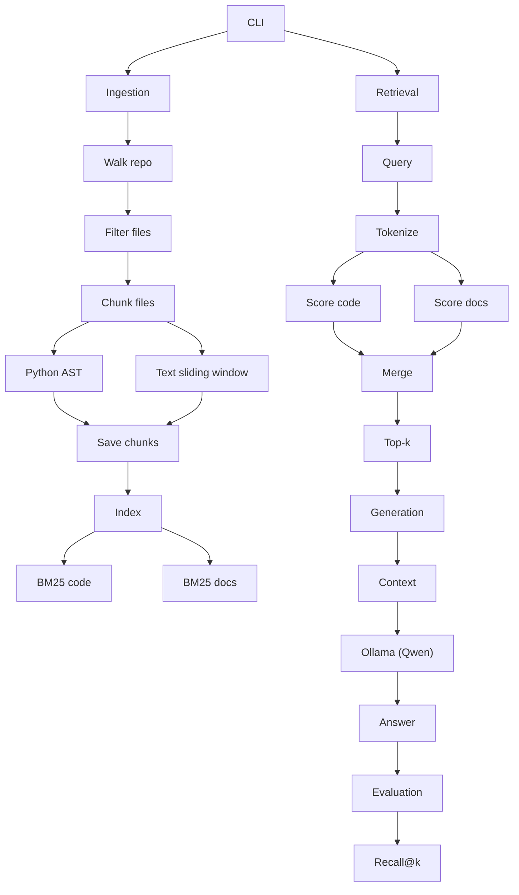
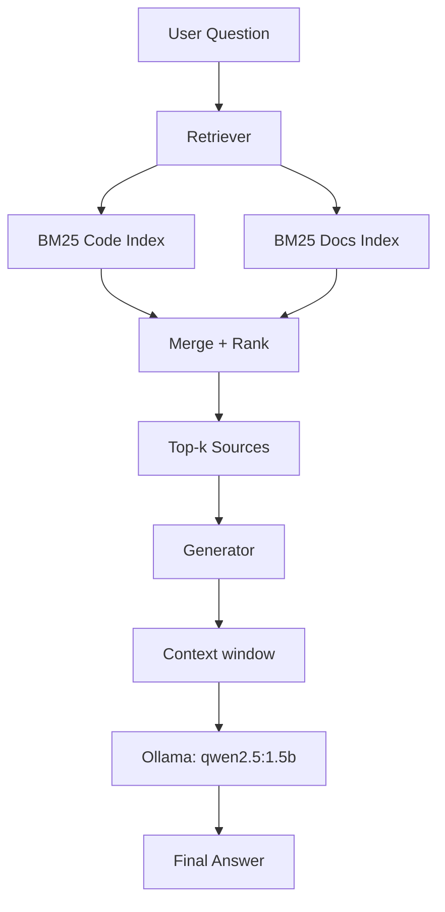
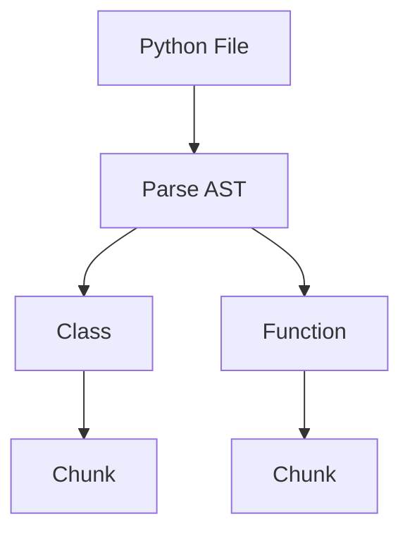
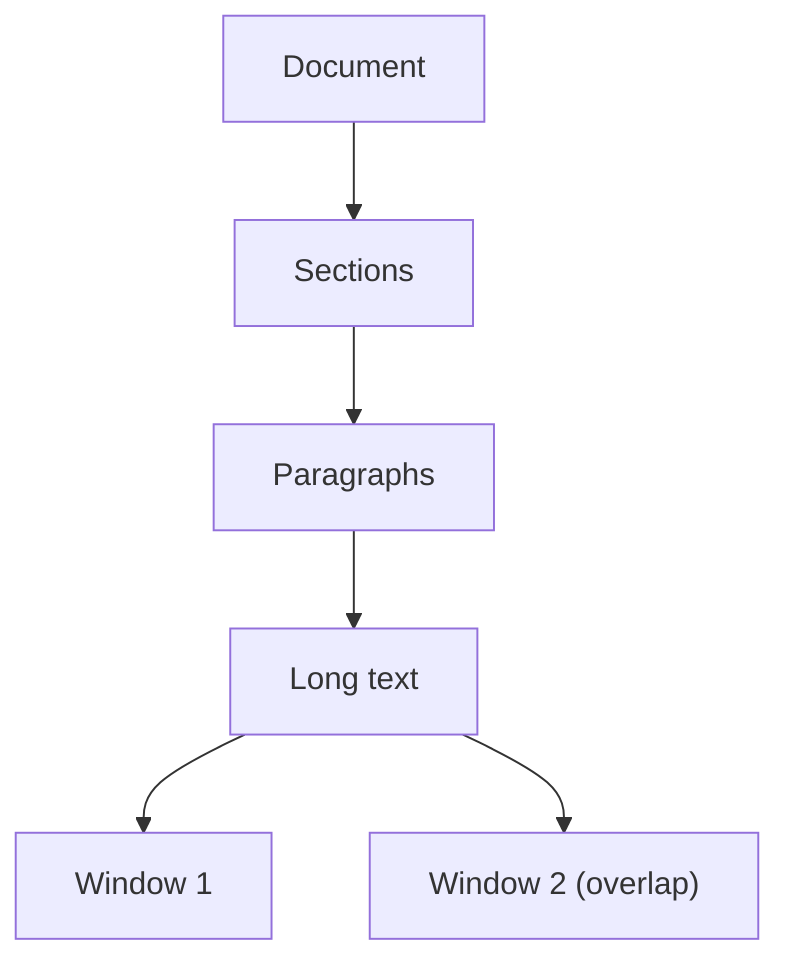
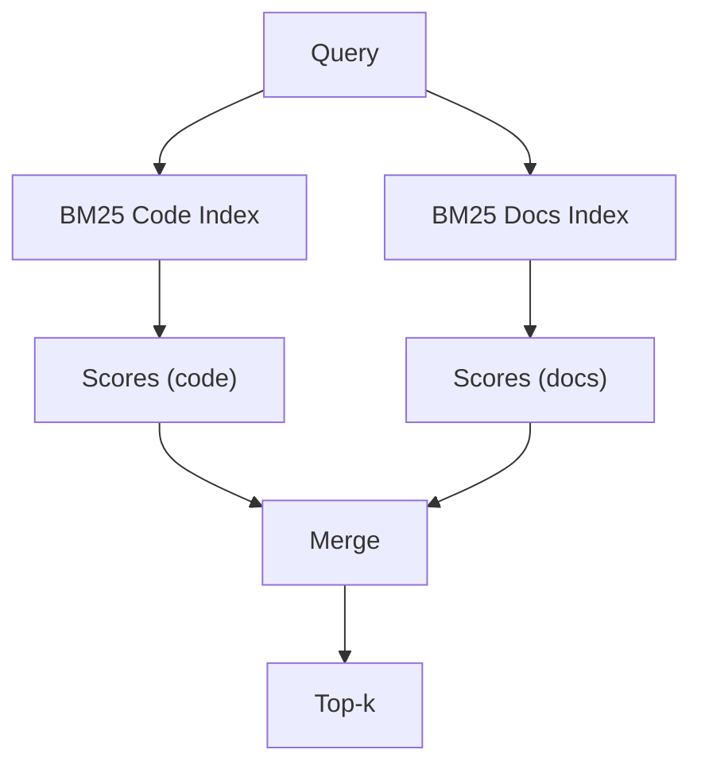
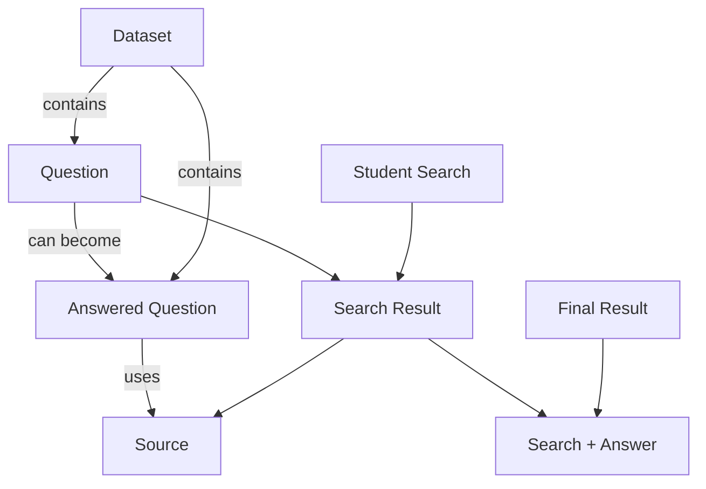
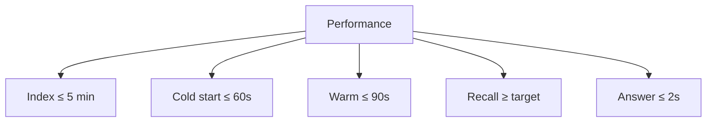

*This project has been created as part of the 42 curriculum by sgil--de.*

# RAG Against the Machine

> A Python RAG (Retrieval-Augmented Generation) system that indexes the vLLM codebase and answers questions about it using BM25 retrieval + Ollama (Qwen) generation.

---

## Table of Contents

1. [Description](#description)
2. [System Architecture](#system-architecture)
3. [Project Structure](#project-structure)
4. [Chunking Strategy](#chunking-strategy)
5. [Retrieval Method](#retrieval-method)
6. [Data Models](#data-models)
7. [Instructions](#instructions)
8. [Pipeline Usage (CLI)](#pipeline-usage-cli)
9. [Performance Analysis](#performance-analysis)
10. [Design Decisions](#design-decisions)
11. [Challenges Faced](#challenges-faced)
12. [Resources](#resources)

---

## Description

RAG Against the Machine is a Retrieval-Augmented Generation system built to answer questions about the vLLM codebase.

It:
- parses a repository,
- chunks files,
- indexes them using BM25,
- retrieves relevant chunks,
- generates answers using a local LLM.

### Goals

- Ingestion: parse and chunk files  
- Retrieval: find relevant chunks  
- Generation: produce grounded answers  
- Evaluation: measure recall@k  

---

## System Architecture

### Global pipeline



---

### Data flow for a single query



---

## Project Structure

```txt
rag-against-the-machine/
│
├── src/
│   ├── __main__.py               ← CLI entry point (Python Fire)
│   ├── models.py                 ← All Pydantic data models
│   │
│   ├── ingestion/
│   │   ├── __init__.py
│   │   ├── walker.py             ← Walk repo, filter by extension
│   │   ├── chunker_python.py     ← AST-based Python chunker
│   │   ├── chunker_text.py       ← Sliding-window text/Markdown chunker
│   │   └── chunk_store.py        ← Save / load chunks JSON to disk
│   │
│   ├── index/
│   │   ├── __init__.py
│   │   └── bm25_index.py         ← Build, save, load BM25 indexes
│   │
│   ├── retrieval/
│   │   ├── __init__.py
│   │   └── retriever.py          ← Query → top-k MinimalSource
│   │
│   ├── generation/
│   │   ├── __init__.py
│   │   └── generator.py          ← Context assembly + Ollama inference
│   │
│   └── evaluation/
│       ├── __init__.py
│       └── evaluator.py          ← recall@k metric
│
├── data/                         ← NOT committed (.gitignore)
│   ├── raw/
│   │   └── vllm-0.10.1/          ← vLLM source repository
│   ├── processed/
│   │   ├── chunks/
│   │   │   ├── code_chunks.json
│   │   │   └── docs_chunks.json
│   │   └── bm25_index/
│   │       ├── code/
│   │       └── docs/
│   ├── datasets/
│   │   ├── AnsweredQuestions/
│   │   │   ├── dataset_code_public.json
│   │   │   └── dataset_docs_public.json
│   │   └── UnansweredQuestions/
│   │       ├── dataset_code_public.json
│   │       └── dataset_docs_public.json
│   └── output/
│       ├── search_results/
│       └── search_results_and_answer/
│
├── tests/
│   ├── test_chunker_python.py
│   ├── test_chunker_text.py
│   ├── test_retriever.py
│   └── test_evaluator.py
│
├── pyproject.toml                ← uv project config + dependencies
├── uv.lock                       ← Locked dependency tree
├── Makefile
├── .gitignore
└── README.md
```

---

## Chunking Strategy

### Python (AST)



---

### Text (Sliding Window)



---

## Retrieval Method

### BM25 Flow



---

## Data Models



---

## Instructions

### Installation

```bash
make install
```

### Ollama setup (required for generation)

```bash
ollama serve
ollama pull qwen2.5:1.5b
```

### Index

```bash
uv run python -m student index --max_chunk_size 2000
```

### Tests

```bash
uv run pytest
```

---

## Pipeline Usage (CLI)

### Search

```bash
uv run python -m student search "question" --k 5
```

### Answer

```bash
uv run python -m student answer "question" --k 10
```

### Evaluate

```bash
uv run python -m student evaluate
```

---

## Performance Analysis



---

## Design Decisions

* BM25 for fast retrieval
* AST chunking for code accuracy
* Separate indexes for code and docs
* Pydantic for validation
* Singleton model loading

---

## Challenges Faced

* Token limit → context truncation
* Model latency → caching
* Code recall → smaller chunks
* Encoding issues → ignore errors

---

## Resources

* [https://en.wikipedia.org/wiki/Okapi_BM25](https://en.wikipedia.org/wiki/Okapi_BM25)
* [https://ollama.com/library/qwen2.5](https://ollama.com/library/qwen2.5)
* [https://github.com/ollama/ollama-python](https://github.com/ollama/ollama-python)
* [https://docs.python.org/3/library/ast.html](https://docs.python.org/3/library/ast.html)
* [https://en.wikipedia.org/wiki/Retrieval-augmented_generation](https://en.wikipedia.org/wiki/Retrieval-augmented_generation)
